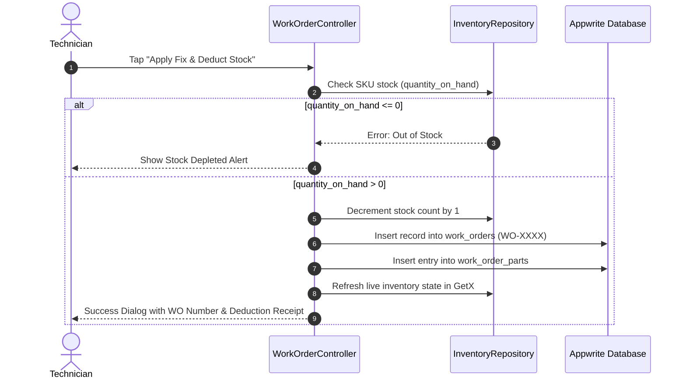

# ResolveFlow — System Architecture & Implementation Plan

## 1. Executive Summary & Vision

**ResolveFlow** is an enterprise mobile diagnostic and inventory-decrementing application engineered for field technicians and inventory managers. It bridges **unstructured symptom diagnostics** with **transactional ledger execution** using Appwrite as the backend and Flutter GetX for reactive state management.

Access control and feature visibility are strictly governed by **Appwrite Teams / Roles (RBAC)** without custom middleware.

```
+-----------------------------------------------------------------------------------+
|                        ResolveFlow Architectural Topology                         |
+-----------------------------------------------------------------------------------+
                                         │
                 ┌───────────────────────┴───────────────────────┐
                 ▼                                               ▼
+----------------------------------+            +----------------------------------+
|   Semantic Diagnostic Layer      |            |    Transactional Ledger Layer    |
|          (VectorsDB)             |            |            (TablesDB)            |
+----------------------------------+            +----------------------------------+
| - Collection: resolutions_vector |            | - parts_inventory                |
| - HNSW Cosine Similarity         |            | - work_orders (WO-XXXX)          |
| - Natural language search query  |            | - work_order_parts (Audit logs)  |
| - Adaptive Knowledge Ingestion   |            | - Inventory validation & decrem. |
+----------------------------------+            +----------------------------------+
                 │                                               │
                 └───────────────────────┬───────────────────────┘
                                         ▼
+-----------------------------------------------------------------------------------+
|                         Appwrite Auth & Role-Based Access                         |
|                                                                                   |
|    Technician Account (`technicians`)            Manager Account (`managers`)     |
|    - Search symptoms in VectorsDB                - Full CRUD on parts_inventory   |
|    - Apply fix & create work_orders              - Audit work_orders & parts log  |
|    - Ingest new resolution vectors               - Restock parts & edit thresholds|
|    - Read-only access to parts_inventory         - Approve / audit vector entries |
+-----------------------------------------------------------------------------------+
                                         │
                                         ▼
+-----------------------------------------------------------------------------------+
|                           Flutter GetX Client Layer                               |
|                                                                                   |
|  - SessionController      <──► Reactive user role (isTechnician, isManager)       |
|  - DiagnosticController   <──► Semantic search & knowledge submission             |
|  - InventoryController    <──► Real-time stock levels & manager CRUD operations   |
|  - WorkOrderController    <──► Transactional execution & deduction orchestration  |
+-----------------------------------------------------------------------------------+
```

---

## 2. Appwrite Auth & RBAC Architecture

Access control is enforced at two synchronized boundaries:
1. **Server-Side (Appwrite Engine)**: Collection and Document level permissions reject unauthorized requests with HTTP `403`.
2. **Client-Side (Flutter GetX)**: UI views, buttons, and navigation options are conditionally rendered based on `AppUser.isTechnician` and `AppUser.isManager`.

### Role-Based Access Control (RBAC) Matrix

| Feature / Collection | Action | Technicians (`team:technicians`) | Inventory Managers (`team:managers`) |
|---|---|:---:|:---:|
| **Semantic Search** (`resolutions_vector`) | Query symptoms & view procedures | ✅ Allowed | ✅ Allowed |
| **Knowledge Ingestion** (`resolutions_vector`) | Add new symptom-fix vectors | ✅ Allowed | ✅ Allowed |
| **Parts Inventory** (`parts_inventory`) | View live stock & bin locations | ✅ Read-only | ✅ Read-only |
| **Parts Inventory** (`parts_inventory`) | Manual edit stock, add part, delete | ❌ Forbidden | ✅ Full CRUD |
| **Apply Fix Action** | Decrement stock via repair trigger | ✅ Allowed (via WO) | ❌ Restricted to Field Tech |
| **Work Orders** (`work_orders`) | Create `WO-XXXX` execution records | ✅ Allowed | ❌ Read & Audit only |
| **Work Order Parts** (`work_order_parts`) | Insert deduction audit entry | ✅ Auto-generated | ❌ Read & Audit only |
| **Audit Logs & Reports** | View all historical technician repairs | 👁️ Own orders | 📊 All orders & analytics |

---

## 3. Design System & Color Palette

The visual identity embodies industrial reliability and contrast compliance (WCAG AA).

### Color Tokens
```dart
abstract final class AppColors {
  // Raw Palette Hex Constants
  static const Color evergreen       = Color(0xFF132A13); // Deep contrast background & dark headers
  static const Color hunterGreen     = Color(0xFF31572C); // Secondary dark elements & surfaces
  static const Color fern            = Color(0xFF4F772D); // Brand Primary action color
  static const Color palmLeaf        = Color(0xFF90A955); // Accent, borders & confidence meters
  static const Color limeCream       = Color(0xFFECF39E); // Surface Highlight & SKU Badges

  // Semantic mappings
  static const Color primary          = fern;
  static const Color primaryDark      = hunterGreen;
  static const Color backgroundDark   = evergreen;
  static const Color accent           = palmLeaf;
  static const Color surfaceHighlight = limeCream;

  // Text on colors (WCAG AA)
  static const Color onPrimary          = Colors.white;
  static const Color onSurfaceHighlight = Color(0xFF132A13); // High contrast text over Lime Cream
}
```

### UI Color Rules
- **Diagnostic Result Card**:
  - Background: Neutral light surface with subtle Hunter Green / Fern borders.
  - **Suggested SKU Chip**: Container filled with `limeCream` (`#ECF39E`), text styled with `evergreen` (`#132A13`) for high visibility.
- **Role Badge**:
  - `Technician`: Fern green badge with tool icon.
  - `Manager`: Hunter green badge with clipboard / inventory icon.
- **Low Stock Badges**: Alert styling with contrast indicators.

---

## 4. Database Schema & Appwrite Permissions

Appwrite database ID: `resolveflow_main`

### A. TablesDB: `parts_inventory`
Live catalog of spare parts and components.
- **Attributes**:
  - `sku` (String, required, unique index): e.g., `"RAD-CAP-04"`, `"THRM-82C"`
  - `name` (String, required): Part name (e.g., "Radiator Pressure Cap 1.1 Bar")
  - `quantity_on_hand` (Integer, required, default: 0): Real-time stock level
  - `min_threshold` (Integer, default: 2): Low-stock warning trigger
  - `unit_price` (Float, optional): Part cost
  - `location` (String, optional): Warehouse bin/shelf (e.g., "Aisle 4, Bin B2")
- **Appwrite Security Rules**:
  - Read: `Permission.read(Role.team('technicians'))`, `Permission.read(Role.team('managers'))`
  - Create / Update / Delete: `Permission.create(Role.team('managers'))`, `Permission.update(Role.team('managers'))`, `Permission.delete(Role.team('managers'))`
  *(Technicians cannot manually change inventory balances; they can only decrement via work order triggers)*.

### B. TablesDB: `work_orders`
Operational log of completed repair interventions.
- **Attributes**:
  - `work_order_number` (String, required, unique): Generated identifier `WO-XXXX`
  - `symptom_title` (String, required): The diagnosed problem description
  - `resolution_summary` (String, required): Fix steps implemented
  - `technician_id` (String, required): Appwrite User ID of the technician
  - `technician_name` (String, optional): Display name
  - `status` (String, default: "completed"): Order status
  - `created_at` (String / DateTime, required): Timestamp of execution
- **Appwrite Security Rules**:
  - Read: `Permission.read(Role.team('technicians'))`, `Permission.read(Role.team('managers'))`
  - Create / Update: `Permission.create(Role.team('technicians'))`, `Permission.update(Role.team('technicians'))`

### C. TablesDB: `work_order_parts`
Immutable ledger of part deductions linked to work orders.
- **Attributes**:
  - `work_order_id` (String, required): Reference to parent work order
  - `sku` (String, required): SKU of deducted part
  - `part_name` (String, required): Name of part deducted
  - `quantity_deducted` (Integer, required, default: 1): Deducted amount
  - `timestamp` (String / DateTime, required): Execution timestamp
- **Appwrite Security Rules**:
  - Read: `Permission.read(Role.team('technicians'))`, `Permission.read(Role.team('managers'))`
  - Create: `Permission.create(Role.team('technicians'))`

### D. VectorsDB: `resolutions_vector`
Semantic troubleshooting knowledge base with cosine similarity search.
- **Attributes**:
  - `title` (String, required): Issue title (e.g., "Coolant Boilover at Highway Speed")
  - `symptom` (String, required): Detailed symptom description
  - `observation` (String, optional): Visual & sensor diagnostic checks
  - `fix_procedure` (String, required): Step-by-step resolution
  - `required_sku` (String, required): Part SKU needed for the fix
  - `similarity_score` (Float, optional): Returned score metadata
- **Appwrite Security Rules**:
  - Read (Search): `Permission.read(Role.users())`
  - Write (Add Knowledge): `Permission.create(Role.team('technicians'))`, `Permission.create(Role.team('managers'))`

---

## 5. Core Business Logic & State Execution

### Flow 1: Semantic Query Execution (Technician)
1. Technician enters freeform text (e.g., *"coolant boiling into reservoir tank after highway speed"*).
2. `DiagnosticRepository.searchResolutions(query)` calls Appwrite using `Query.search('symptom', query)` and semantic vector matching.
3. Maps raw documents to strongly typed `ResolutionResult` objects.
4. If similarity $< 0.60$ or zero items are returned, the UI dynamically displays the **Knowledge Ingestion Form**.

### Flow 2: Transactional State Execution (`executeWorkOrder`)
When the technician clicks **"Apply Fix & Deduct Stock"**:


### Flow 3: Adaptive Knowledge Ingestion (`addNewResolutionKnowledge`)
When an unmatched or newly solved symptom occurs:
1. Technician or Manager fills inline fields:
   - **Symptom Title**
   - **Diagnostic Observation**
   - **Fix Implemented**
   - **Required SKU** (selected from inventory dropdown or entered)
2. Submits via `DiagnosticController.submitNewKnowledge()`.
3. Appends document directly to `resolutions_vector`.
4. Immediately re-runs search so the new procedure appears at the top.

### Flow 4: Inventory Management & Audit (Manager)
1. Manager accesses Live Inventory Screen / Drawer:
   - Views real-time stock levels, low-stock warnings, and warehouse locations.
   - **Manager Actions**: Add New Part, Restock Quantity (+N), Update Unit Price, Edit Threshold.
2. Manager accesses Work Orders Audit Tab:
   - Views complete history of all work orders created by technicians with timestamps and parts deducted.

---

## 6. Role-Gated UI & Screen Breakdown

### Role Detection
Existing `AppUser` in `lib/src/models/user_model.dart`:
```dart
bool get isTechnician => teams.contains('technicians');
bool get isManager => teams.contains('managers');
```

### 1. Main Home & Navigation Scaffold
- **Top Bar**:
  - ResolveFlow branding in Evergreen `#132A13`.
  - User profile with dynamic role badge (`Technician` in Fern Green or `Inventory Manager` in Hunter Green).
- **Navigation Tabs / Modes**:
  - **Diagnostics Tab** (Primary for Technicians, searchable by both).
  - **Live Inventory Tab / Drawer** (Technicians have read-only view; Managers have CRUD restock controls).
  - **Work Orders & Audit Tab** (Technicians see their own work orders; Managers audit all technician orders).

### 2. Semantic Diagnostic Screen (`/diagnostic`)
- Natural language symptom search bar.
- Result card displaying:
  - Match confidence badge (`94% match`).
  - Title and diagnostic observation.
  - Step-by-step fix procedure.
  - **Suggested SKU Chip**: Highlighted in Lime Cream (`#ECF39E`) with Evergreen (`#132A13`) text.
  - **"Apply Fix & Deduct Stock" Button**: Active for Technicians.

### 3. Dynamic Knowledge Ingestion Form
- Rendered inline when similarity $< 0.60$ or no matches found.
- Fields: Title, Observation, Fix Procedure, Required SKU.
- Submits directly to `resolutions_vector`.

### 4. Live Inventory Screen / Drawer
- Color-coded stock badges:
  - Healthy ($\ge \text{min\_threshold}$): Fern Green
  - Low Stock ($< \text{min\_threshold}$): Amber / Warning
  - Depleted ($= 0$): Red / Error
- If Manager: Floating Action Button **"Add Part"** and inline **"Restock"** action buttons.
- If Technician: Clean read-only stock lookup to check part availability before heading to the warehouse.

---

## 7. Step-by-Step Implementation Roadmap

1. **Step 1: Color Palette & Theme**
   - Create `lib/src/theme/resolveflow_colors.dart` with the 5 exact colors.
   - Integrate with Material 3 `ColorScheme` and `AppColorsExtension`.

2. **Step 2: Database Setup & Seed Updates**
   - Update `scripts/setup_appwrite.dart` to include:
     - Teams: `technicians`, `managers`
     - Collections: `parts_inventory`, `work_orders`, `work_order_parts`, `resolutions_vector`
     - Seed data: 5 sample automotive/industrial parts and 3 diagnostic symptom-fix vectors.
   - Update `lib/src/config/appwrite_collections.dart`.

3. **Step 3: Domain Models**
   - `ResolutionResult`: VectorsDB symptom-fix entity.
   - `InventoryPart`: TablesDB `parts_inventory` entity.
   - `WorkOrder`: TablesDB `work_orders` entity (`WO-XXXX`).
   - `WorkOrderPart`: TablesDB `work_order_parts` audit entity.

4. **Step 4: Repositories (MVC Services)**
   - `DiagnosticRepository`: Appwrite vector search and knowledge ingestion.
   - `InventoryRepository`: Stock queries, stock validation, and decrement logic.
   - `WorkOrderRepository`: Work order generation (`WO-XXXX`) and audit logging.

5. **Step 5: GetX Controllers**
   - `SessionController`: Auth state with reactive `isTechnician` and `isManager`.
   - `DiagnosticController`: Natural language search state and knowledge ingestion.
   - `InventoryController`: Reactive inventory list, real-time restock & decrement updates.
   - `WorkOrderController`: Transaction orchestration and modal feedback.

6. **Step 6: Role-Aware UI Screens & Components**
   - Diagnostic Search & Result Card with Lime Cream SKU chip.
   - Dynamic Knowledge Ingestion Form.
   - Live Inventory Screen / Drawer (with Manager Restock vs Technician Read-only).
   - Work Orders & Deduction Audit History View.

7. **Step 7: Verification**
   - Test Technician role: Search $\to$ Match $\to$ Apply Fix $\to$ Deduct 1 stock $\to$ Verify `work_orders` + `work_order_parts`.
   - Test Manager role: Restock part $\to$ Edit part $\to$ Audit technician work orders.
